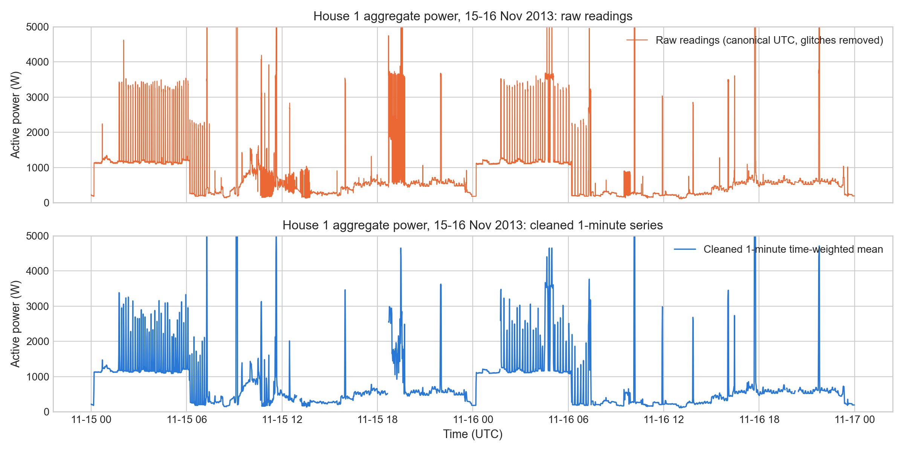
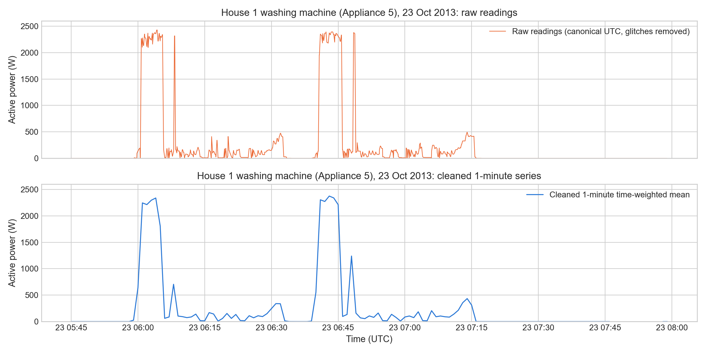
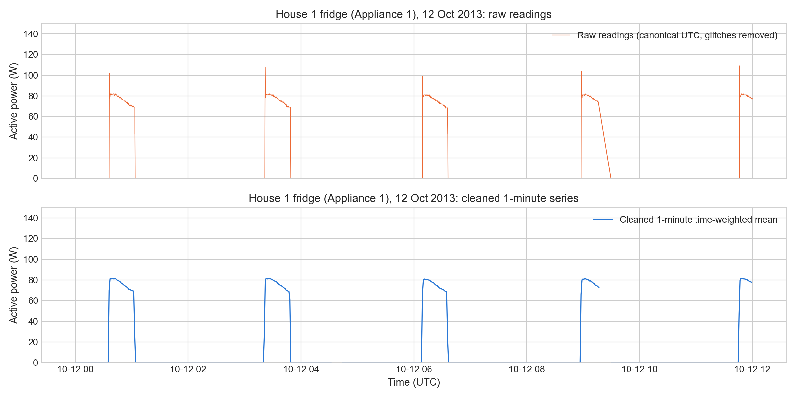

# DATA.md: Data Coverage, Quality Findings and Cleaning Decisions

This is a summary across all phases. Full detail and every number's source table are in the phase documents:

- [phase1/DATA.md](phase1/DATA.md): raw House 1
- [phase2/DATA.md](phase2/DATA.md): official cleaned data, washing-machine channels
- [phase3/DATA.md](phase3/DATA.md): the modelling dataset

## 1. Data used

| Phase | Source | Households | Period | Sampling | Units |
|---|---|---|---|---|---|
| 1: raw cleaning | REFIT **raw** release, `RAW_House1_Part1.csv`, `RAW_House1_Part2.csv` | House 1 | 2013-10-09 to 2015-07-10 (UTC) | irregular, about 7 s median; resampled to 1 min | active power, W |
| 2: EDA | REFIT **official cleaned** release, `CLEAN_House{N}.csv` | 2, 5, 7, 8, 9, 15 | each house's full record, Sep 2013 to Jul 2015 | irregular 6–8 s (median 7 s); 1-minute means | W |
| 3: model | official cleaned release | 2, 7, 8, 9, 15 (House 5 excluded: probable washer-dryer) | chronological 60/20/20 split per house; test periods Feb–Jul 2015 | 1-minute means | W |
| 4: implications | Phase 2/3 data and outputs (read only) | 2, 7, 8, 9, 15 | as Phase 3 | 1 minute; 15 and 30 min as an illustration | W, kWh |

The REFIT documentation is the official readme (copy at [docs/CLEAN_READ_ME_081116.txt](docs/CLEAN_READ_ME_081116.txt))
and Murray et al. (2017), *Scientific Data* 4, 160122. The data are licensed CC BY 4.0. The archives are not in this
repository; README → Setup explains how to download them.

## 2. Raw data (House 1): coverage and quality findings

Source: [phase1/RESULTS.md](phase1/RESULTS.md) and `outputs/tables/phase1/`.

| Check | Finding |
|---|---|
| Timestamp parsing | `Time` is the **UK wall clock** (BST in summer). `Unix` is that clock value read as UTC, so it is **not UTC in summer**. Clock changes are visible: on 27 Oct 2013 the clock goes back from 01:59:59 to 01:00:01, and in spring 2014 and 2015 it jumps from about 01:00 to 02:00 |
| Ordering | Part 1 has 1 backward step in raw `Unix` (the 2013 clock change); there are 0 after conversion to UTC |
| Duplicate timestamps | Part 1 has 1,004,404 rows sharing a second; Part 2 has 14,755 |
| Missing readings | Part 1 has no NaN, but records an unavailable sensor as 0 W. Part 2 has 5,284,083 NaN cells (a channel not reported in that packet) |
| Irregular intervals and outages | Median interval 7 s. There are 26 Aggregate gaps over 1 h; the longest is 41.6 days (24 Jan to 6 Mar 2014) |
| Extreme values | 3,949 appliance readings above 4 kW (up to 98,301 W, which are sensor errors). 3 aggregate readings above 25 kW. No negative readings |
| Two files | Part 1 and Part 2 overlap for about 3 months in 2014, share the same clock and carry the same signals |

**Cleaning pipeline** ([phase1/run_cleaning.py](phase1/run_cleaning.py)):

1. **Convert to UTC.** Subtract 1 h during BST. The repeated hour on 27 Oct 2013 is assigned by file order. The
   repeated hour on 26 Oct 2014 is interleaved and cannot be split, so its rows are removed, leaving a 2-hour gap.
2. **Physical limits.** Appliance readings above 4 kW, aggregate readings above 25 kW and negative readings are set
   to missing. The official REFIT cleaning instead sets IAM spikes to 0 W.
3. **Handoff.** Part 1 is used up to 2014-09-27 13:51:12 UTC and Part 2 after it.
4. **Duplicates (stated rule).** Within each UTC second, each channel keeps its last non-missing reading. No
   reading is lost.
5. **Short gaps.** Each reading is held until the channel's next reading, for at most 60 s (aggregate, washer-dryer,
   washing machine, dishwasher) or 120 s (other channels).
6. **Long outages.** These are flagged and left missing, never filled (table 13).
7. **1-minute resampling.** Exact time-weighted means. A minute is kept only if at least 30 s of it is covered.

The pipeline writes nothing unless all 37 validation assertions pass.

**Before and after cleaning** (aggregate plus two appliance channels):

## 3. Official cleaned data (Phases 2–3): preparation and decisions

**Preparation** ([phase2/wm_eda.py](phase2/wm_eda.py), reused read-only by Phase 3):

1. Sort the readings and drop duplicate timestamps.
2. Mask frozen readings: the same value held for more than 60 min, with the washing-machine channel masked only
   above 20 W.
3. Take 1-minute arithmetic means.
4. Fill no gaps.

**Availability.** 75.4% (House 2) to 89.7% (House 8) of minutes. Outages hit several houses on the same dates
(Jan–Mar 2014, May 2015, Jun 2015), which points to collection-system failures.

**Phase 3 exclusions**, applied to every house:

- whole UTC days with 60 or more frozen aggregate minutes are dropped (House 9 investigation);
- minutes where the washing machine reads more than 100 W above the aggregate are dropped;
- minutes missing either channel are dropped.

## 4. Remaining concerns

- **Official-file timestamps: corrected.** The official cleaned files store **UK local time, not UTC, in their
  Part 2 summer periods** (from each file's switch to raw Part 2 on 30 Sep 2014 to 26 Oct 2014, and from 29 Mar 2015).
  - Confirmed for every Phase 2–4 house (`audit/official_timestamp_check.py`, `outputs/tables/audit/`).
  - Phase 2's loader converts those rows to UTC before any analysis ([phase2/DATA.md §1](phase2/DATA.md)). It drops
    the interleaved repeated hour of 26 Oct 2014, leaving a 2-hour gap, and the duplicated switch hour.
  - The fix re-times 18.6% of Phase 2 cycles, 66.3% of Phase 3 test minutes and 18.0% of Phase 4 window minutes.
  - **Residual:** the official Part 1 conversion leaves a 1-hour artefact at the 2013–14 clock changes (for example
    an empty 00:00 UTC hour on 30 Mar 2014). These cannot be separated and are left as they are.
- **House 1 logger clocks.** The two House 1 logger clocks drift apart by up to 7 minutes in summer 2014. There is
  no reference clock to correct this.
- **Hidden short dropouts.** The official release forward-fills gaps, so short dropouts are hidden. Only frozen
  stretches of over 60 min are detected.
- **House 5.** Its washing-machine channel is probably a washer-dryer: it is kept in the EDA but excluded from
  modelling.
- **Unmetered large loads.** Some aggregates contain large loads that no sub-meter records, probably showers or
  storage heating. The `Issues` flag is not used to drop minutes.
- **No ground truth.** There is no record of actual wash loads: a "cycle" is an electrical activity pattern, not a
  confirmed load.
