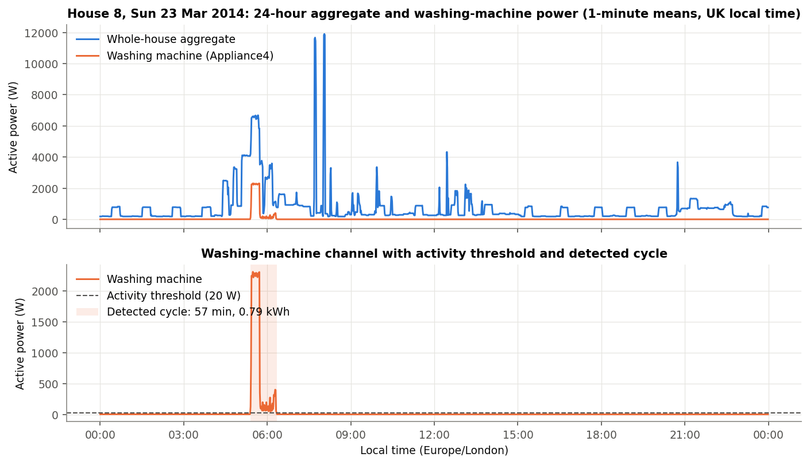
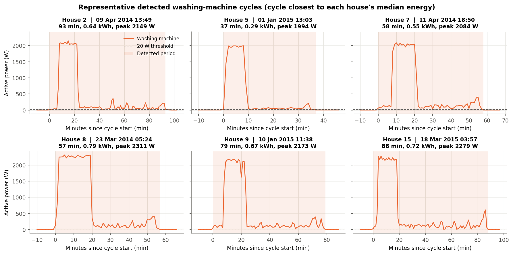
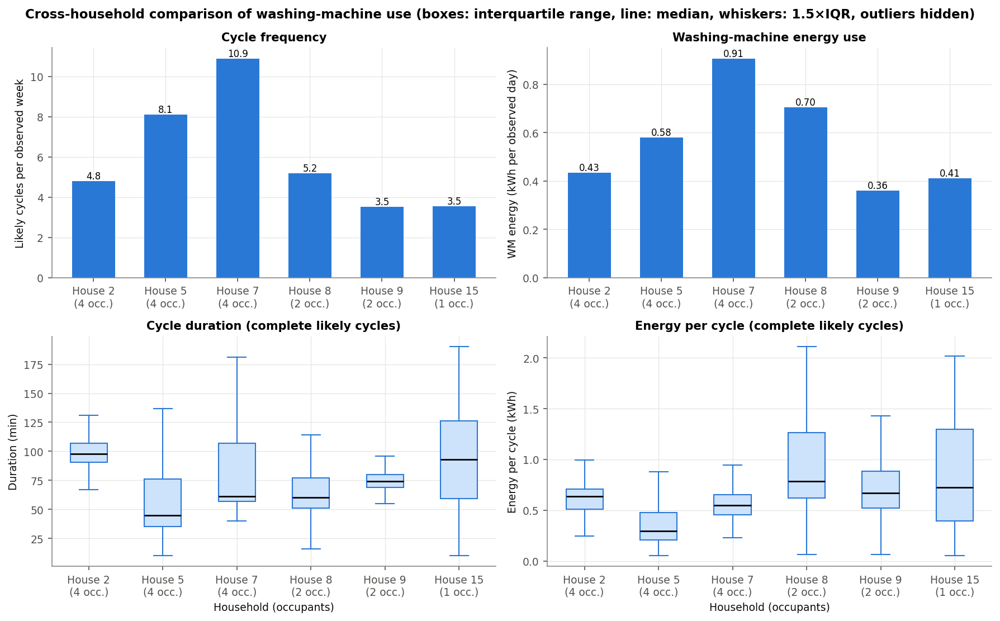
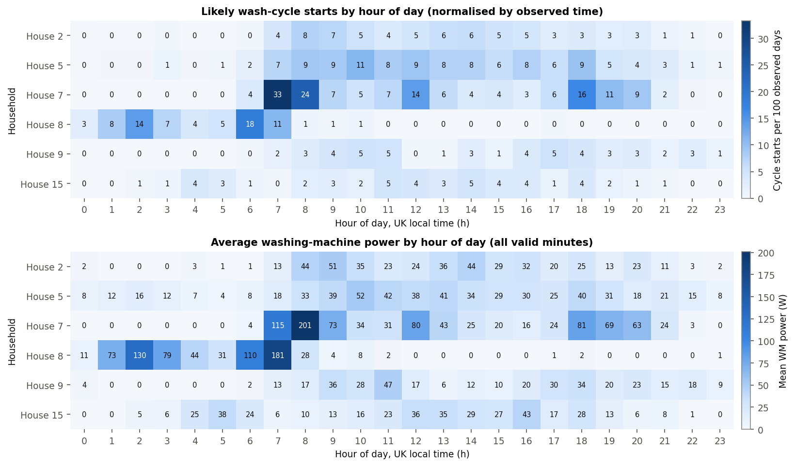
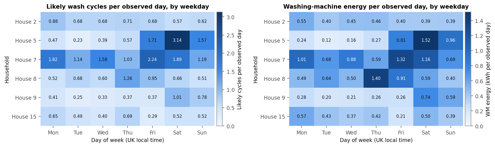
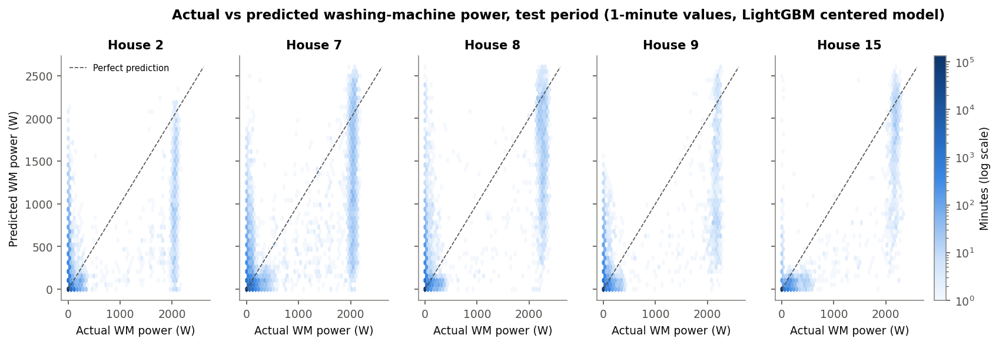
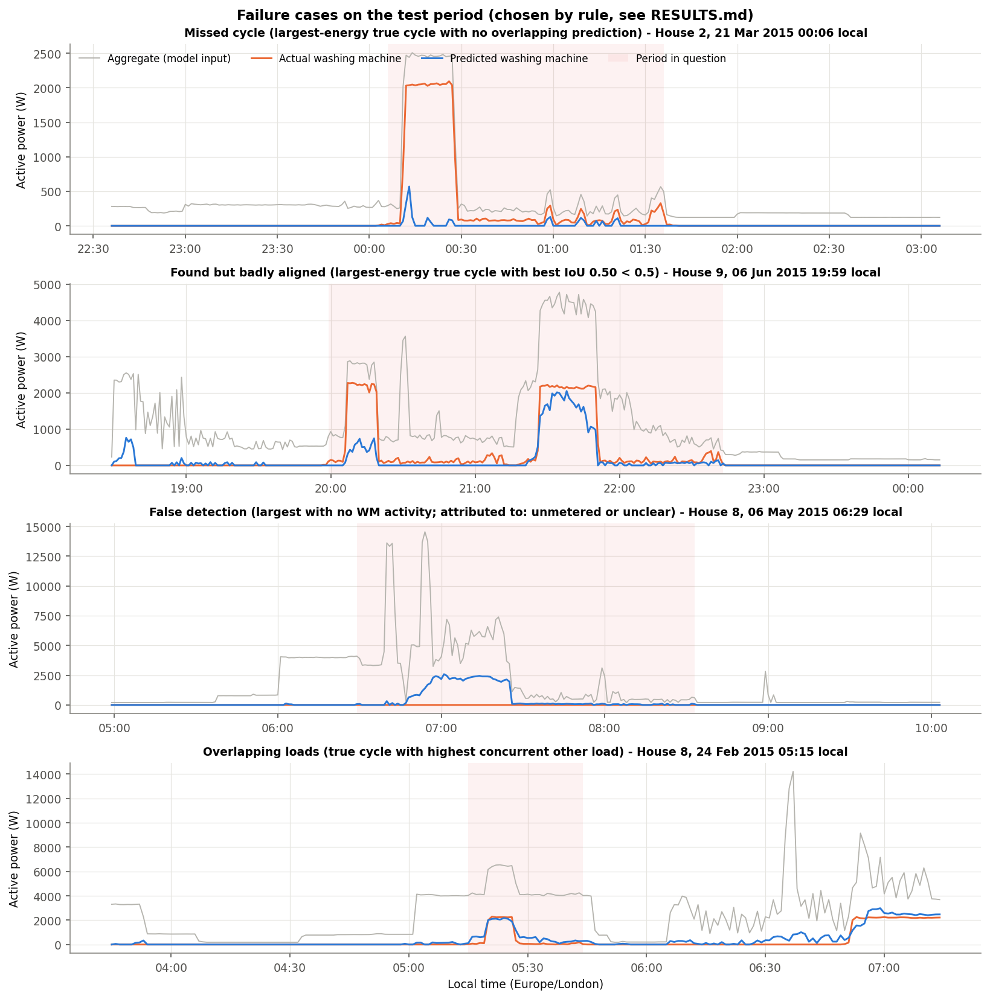

# RESULTS.md: Washing-Machine EDA, Disaggregation Model and Evaluation

This is a summary. Full analysis and source tables:

- [phase2/RESULTS.md](phase2/RESULTS.md): EDA
- [phase3/RESULTS.md](phase3/RESULTS.md): model and evaluation
- [phase4/RESULTS.md](phase4/RESULTS.md): practical implications
- [phase1/RESULTS.md](phase1/RESULTS.md): raw-data cleaning validation

Every number below comes from `outputs/tables/`.

> **Clock correction applied.** The official REFIT files use UK local time, not UTC, in their Part 2 summer periods
> (see [DATA.md §4](DATA.md#4-remaining-concerns)). All results below use timestamps corrected to UTC. Compared with
> the uncorrected run
> ([`07_baseline_vs_corrected_metrics.csv`](outputs/tables/audit/07_baseline_vs_corrected_metrics.csv)):
> - cycle counts, durations and energies are essentially unchanged (2,678 → 2,676 cycles);
> - Phase 3 metrics change slightly (minute F1 0.556 → 0.577, cycle F1 0.533 → 0.536);
> - Phase 4's peak-window share of washes rises from 12.8% to 14.3%.

## 1. Washing-machine EDA (Phase 2)

**Homes and periods.** Houses 2, 5, 7, 8, 9 and 15 from the official cleaned data, each over its full record
(Sep 2013 to Jul 2015), at 1-minute resolution.

**Cycle rule, in plain language.** The machine counts as active when it draws **more than 20 W**. Pauses of up
to **15 minutes** are joined into one activity period. A period counts as a **likely wash cycle** if it lasts
10–300 min, uses at least 0.05 kWh and peaks above 200 W. Threshold sensitivity is checked in
`outputs/tables/phase2/09_threshold_sensitivity.csv`.

**Key findings:**

- **Cycles found:** 2,676 likely cycles; 2,472 of them are complete and used for duration and energy statistics.
- **Frequency:** varies about 3×, from 3.5 cycles per week (Houses 9 and 15) to 10.9 (House 7).
- **A typical cycle:** 0.29–0.79 kWh and 45–98 min (house medians). In every house, 90–100% of complete cycles
  include a ~2 kW water-heating block.
- **Share of household use:** washing machines are 2.7–6.8% of household electricity, but they are a
  concentrated ~2 kW load that can be scheduled.
- **Timing is household-specific:**
  - House 8 starts 80.5% of its cycles between 00:00 and 07:00 (a timer or off-peak tariff).
  - House 7 peaks at 07:00–08:00.
  - Houses 5 and 9 wash 2.6–3.5× more often per day at weekends.

**(i) Representative 24-hour trace.** Chosen by rule: House 8, 23 Mar 2014. The 2.3 kW heating block is clearly
visible in the aggregate. The ~40-minute low-power tail is almost invisible.

**(ii) Detected cycles.** In every house a cycle has the same shape: heating first, then a low-power drum and
spin phase.

**(iii) Cross-house comparison.**

- **Frequency drives total washing-machine energy.** House 7 uses the most because it washes most often; its
  cycles are mid-sized.
- **Cycle size differs about 2.7×** (median 0.29 to 0.79 kWh), mainly with heating time, i.e. wash temperature.
- **Occupancy explains only part of it.** House 2 has 4 occupants but washes about as often as the 2-person
  House 8.

**Usage by hour and weekday:**

## 2. Disaggregation model (Phase 3)

| Item | Choice |
|---|---|
| Task | Estimate 1-minute washing-machine power from the whole-house aggregate only |
| Homes | 2, 7, 8, 9, 15 (official cleaned data; House 5 excluded as a probable washer-dryer) |
| Model | LightGBM on 48 aggregate-window features (±60 min, in the spirit of Seq2Point), clipped to [0, aggregate], gated at τ = 50 W chosen on validation |
| Baselines | Always off; per-house hour-of-day mean profile |
| Validation design | Per-house **chronological** 60/20/20 train/validation/test split with 1-day buffers, so no feature window spans two splits. The test is later in time than training. **Leave-one-house-out (LOHO):** each fold trains and chooses τ without the held-out house, which tests a genuinely unseen household. The test data are used once |

**Metrics:**

- **RMSE** penalises missing the 2 kW heater block.
- **MAE** is shown, but it rewards an always-off prediction for a mostly-off appliance.
- **Energy error** is what bill-level insight needs.
- **Minute F1** is the standard on/off NILM metric.
- **Cycle precision, recall and F1** use one-to-one matching at temporal IoU ≥ 0.5, which asks "did a wash happen,
  and when?"

**Results on the pooled test period:**

| Metric | LightGBM (±60 min) | LightGBM (causal, past 60 min) | Hour-of-day profile | Always off |
|---|---|---|---|---|
| RMSE (W) | **126.0** | 146.1 | 215.9 | 220.3 |
| MAE (W) | **20.8** | 24.5 | 44.7 | 27.5 |
| Minute F1 | **0.58** | 0.52 | 0.23 | 0.00 |
| Energy error | −5.9% | −11.5% | −19.2% | −100% |

| Cycle detection (IoU ≥ 0.5, one-to-one) | Recall | Precision | F1 |
|---|---|---|---|
| Within-house (unseen time) | 77.6% (337/434) | 40.9% (337/823) | 0.54 |
| Leave-one-house-out (unseen home) | 67.7% (294/434) | 28.2% (294/1043) | 0.40 |

**Actual vs predicted (test data).** Most minutes sit at (0, 0). True heater minutes form a vertical band at
about 2 kW: the model usually recognises them but under-predicts. The low-power tail is predicted near 0.
Points at "actual 0, predicted > 0" are false detections.

**Interpretation.**

- The model clearly beats both baselines on RMSE and F1. Always-off has a lower MAE than the model in House 2,
  and nearly ties it in House 9.
- The good pooled energy error (−5.9%) is partly a coincidence. Each true cycle is under-estimated (50–76% of its
  energy is assigned), and false detections fill the gap.
- On unseen homes, energy errors reach +42% and +37% (Houses 8, 9) and −50% (House 15).

**Failure cases** (chosen by rule; [phase3/RESULTS.md §7](phase3/RESULTS.md)):

1. **A missed cycle.** A clear heater block just after midnight is predicted only as a brief spike, too short to
   form a cycle (House 2).
2. **False detections.** Other ~2 kW heating loads look like washing: dishwasher, kettle, tumble dryer, or large
   unmetered loads (House 8, morning, with 4–14 kW of other load).
3. **Mis-timing.** Two heater blocks that the cycle rule joins into one wash are predicted as separate cycles
   (House 9). More generally, the predicted cycle stops when the heater stops, so long programmes and back-to-back
   loads get poor start and end times.
4. **Overlapping loads.** The heater is tracked, but energy leaks into a surrounding 4–6 kW period (House 8).

Cold washes, with no heater block, and new homes without local training data are where the model will struggle
most.

## 3. Practical implications (Phase 4)

The utility-facing summary and the answers to Section 4 are in [Recommendation.md](Recommendation.md):

- the opportunity
- how to measure whether it worked
- limitations, including applying UK results to India
- what 15- or 30-minute data would lose

Supporting analysis is in [phase4/RESULTS.md](phase4/RESULTS.md).

## 4. Raw-data cleaning validation (Phase 1)

The House 1 pipeline converts the UK local clock to UTC and conserves the energy of the observed signal. Cleaned
and raw energy agree within 0.31% in three test windows and within 0.09% per channel over the full record.
Phase 1 is **provisional** because the two logger clocks drift by up to 7 minutes and this cannot be corrected
([phase1/RESULTS.md](phase1/RESULTS.md)).
