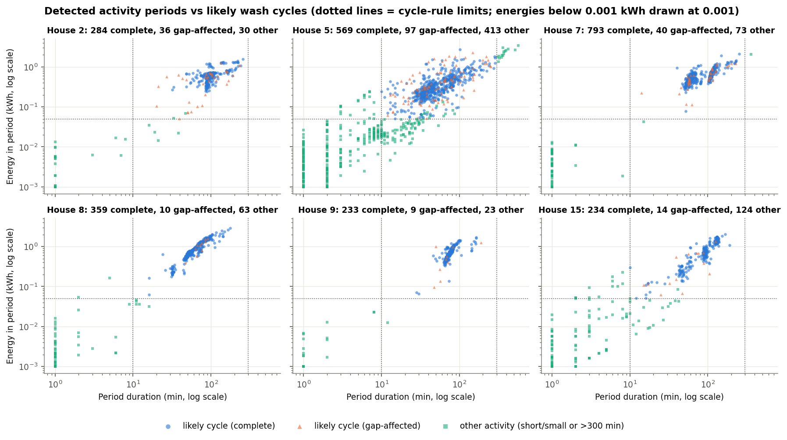
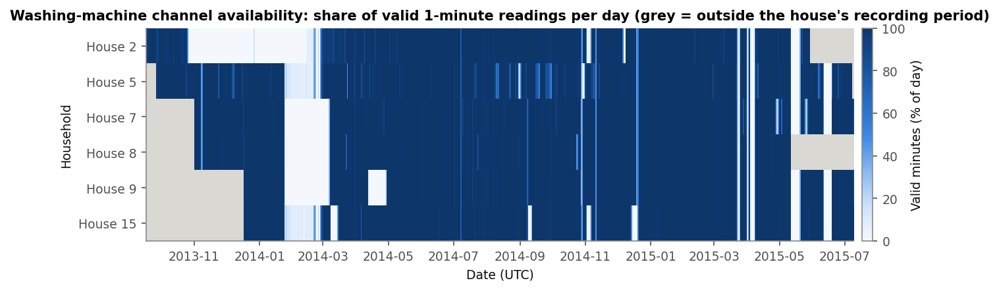
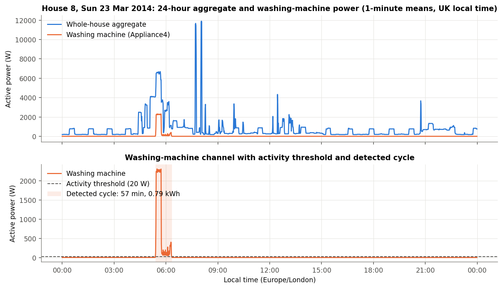
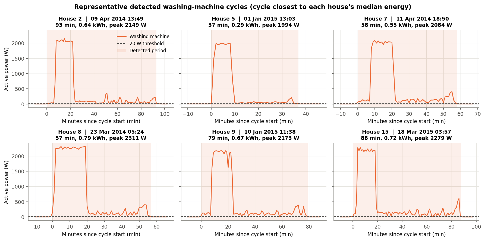
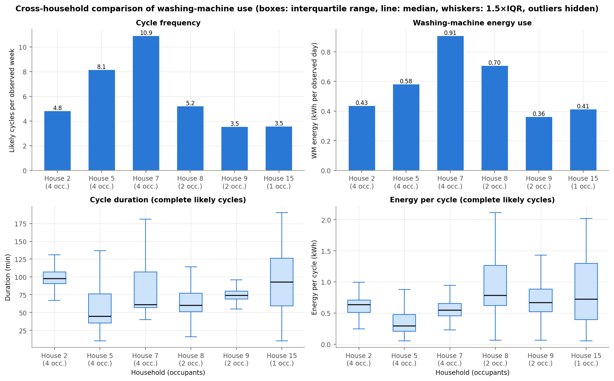
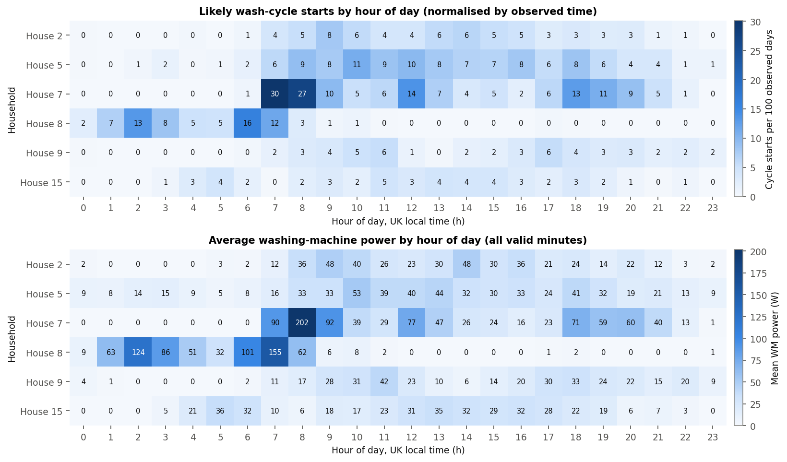
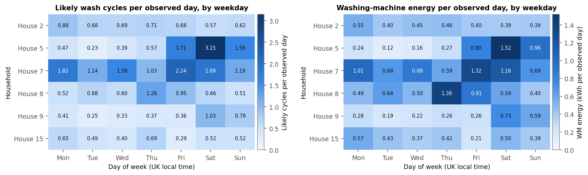

# Phase 2 Results: Exploratory Analysis of Washing-Machine Use

**Data:** official cleaned REFIT release, 1-minute resolution. Six households (2, 5, 7, 8, 9, 15), each over its
full available record (Sept 2013 – July 2015; exact dates in [DATA.md §5](DATA.md#5-availability-and-data-quality-findings)).
**Code:** [`wm_eda.py`](wm_eda.py) (`python3 phase2/wm_eda.py`, about 20 s) or the notebook
[`02_washing_machine_eda.ipynb`](02_washing_machine_eda.ipynb). Both produce the same outputs.
**Numbers:** every value here is in [`outputs/tables/phase2/`](../outputs/tables/phase2/). The headline values
are collected in [`12_key_numbers.csv`](../outputs/tables/phase2/12_key_numbers.csv).

---

## 1. Summary

- **2,678 likely wash cycles** were detected across the six homes. Of these, 2,472 are complete (no missing data
  nearby) and are used for duration and energy statistics.
- **Frequency varies about 3×:** from 3.5 cycles per week (Houses 9 and 15) to 10.9 per week (House 7).
- **A typical cycle uses 0.29–0.79 kWh** (house medians) and lasts 45–98 min. Almost every complete cycle
  (90–100% per house) includes a ~2 kW water-heating phase near the start.
- **Washing machines are a small share of household electricity:** 2.7–6.8% of aggregate energy. They are,
  however, a concentrated ~2 kW load that can be scheduled.
- **Timing is household-specific.** House 8 starts 77% of its cycles between midnight and 07:00 (delay timer or
  off-peak tariff). House 7 peaks at 07:00–08:00. Houses 5 and 9 wash 2.6–3.5× more often per day at weekends.
- **Occupancy alone does not predict use.** The two most frequent users are 4-person homes, but the third
  4-person home (House 2) washes about as often as a 2-person home.

---

## 2. How cycles were identified

**Rule, in plain language**

1. **Active minute:** the washing machine draws **more than 20 W** on average in that minute. In all six homes,
   idle/standby readings are 0–6 W. The drum motor alone draws ~50–300 W and the heater ~2 kW, so 20 W sits well
   between "idle" and "doing something".
2. **Activity period:** active minutes are joined into one period if the pauses between them are **15 minutes or
   less**. Washing programmes pause briefly between fill, wash, rinse and spin. Measured pauses between active
   minutes cluster at 5 min or less, while separate uses are usually more than an hour apart.
3. **Likely wash cycle:** an activity period lasting **10–300 min**, using **at least 0.05 kWh** and peaking
   **above 200 W**. Anything else is "other activity":
   - short blips from door locks, pump-outs or programme selection
   - very long periods (see House 5 below)
4. **Complete vs gap-affected:** a likely cycle with any missing minute inside it, or within 15 min of either end,
   is *gap-affected*. It counts towards frequency but not towards duration or energy statistics.

> **Detected activity ≠ confirmed wash.** REFIT has no log of actual loads. A "likely cycle" is an electrical
> pattern that looks like a programme. Two loads run back-to-back within 15 min are counted as one. A programme
> with a pause longer than 15 min (for example a soak) is counted as two. House 5's channel may include drying
> (see DATA.md §2).

**Counts by category** ([`06_cycle_summary_by_house.csv`](../outputs/tables/phase2/06_cycle_summary_by_house.csv)):

| House | Activity periods | Likely cycles | of which complete | of which gap-affected | Short/small activity | Long (>300 min) |
|---|---|---|---|---|---|---|
| 2 | 350 | 320 | 284 | 36 | 30 | 0 |
| 5 | 1079 | 666 | 569 | 97 | 398 | 15 |
| 7 | 906 | 833 | 793 | 40 | 72 | 1 |
| 8 | 432 | 369 | 359 | 10 | 63 | 0 |
| 9 | 265 | 242 | 233 | 9 | 23 | 0 |
| 15 | 372 | 248 | 234 | 14 | 124 | 0 |

**Interpretation.** In Houses 2, 7, 8 and 9, the likely cycles form one tight cluster (roughly 30–200 min and
0.2–2 kWh), well separated from the small "other" blips. The rule is therefore not sitting on a boundary.
Houses 5 and 15 have many 1–10-minute blips. House 5's periods form a continuous spread up to 572 min, which
matches the washer-dryer concern.

**Sensitivity** ([`09_threshold_sensitivity.csv`](../outputs/tables/phase2/09_threshold_sensitivity.csv)).
The threshold and pause length were varied (10/20/50 W × 5/10/15/30 min):

| House | Likely cycles at chosen setting (20 W, 15 min) | Range across 12 settings | Range as % of chosen |
|---|---|---|---|
| 2 | 320 | 301–375 | 23.1% |
| 5 | 666 | 596–722 | 18.9% |
| 7 | 833 | 798–904 | 12.7% |
| 8 | 369 | 362–369 | 1.9% |
| 9 | 242 | 233–254 | 8.7% |
| 15 | 248 | 234–257 | 9.3% |

The **power threshold barely matters.** At a 15-min pause, moving from 10 W to 50 W changes counts by at most
14 cycles in any house (House 5: 655–669). Most of the spread comes from the **pause length** (5 vs 30 min), which decides whether
a long internal pause splits a programme. Houses 7 and 5 are the two most frequent users under every setting.
The near-tied pairs (House 8 vs 2, and 9 vs 15) can swap order, so their ranking should not be over-read.

---

## 3. Data availability (short version; full detail in [DATA.md](DATA.md))

| House | Span (days) | Observed days | WM availability | Longest gap |
|---|---|---|---|---|
| 2 | 617.4 | 465.4 | 75.38% | 62.0 d from 2013-10-25 |
| 5 | 648.3 | 574.0 | 88.53% | 8.6 d from 2015-05-10 |
| 7 | 613.2 | 536.0 | 87.41% | 41.6 d from 2014-01-24 |
| 8 | 555.1 | 498.1 | 89.73% | 39.1 d from 2014-01-26 |
| 9 | 568.1 | 480.7 | 84.62% | 41.6 d from 2014-01-24 |
| 15 | 567.4 | 489.7 | 86.31% | 8.6 d from 2015-05-10 |

Several long gaps happen on the same dates in several houses: early 2014, and May and June 2015. These are
collection failures across the study, not household behaviour. Missing minutes are never counted as "off".
All rates below divide by **observed** time.

---

## 4. Required plots and interpretation

### (i) Representative 24-hour aggregate and washing-machine trace

Chosen by rule ([`11_representative_day.csv`](../outputs/tables/phase2/11_representative_day.csv)): a House 8
day with at least 95% valid data on both channels and exactly one complete cycle, picking the cycle closest to
the house's median energy. Result: **Sunday 23 March 2014**, a 57-min cycle starting 05:24 local time,
0.79 kWh, peak 2311 W.

**Interpretation.** The cycle is a short, distinctive event in the day:
- **Heating block:** about 2.3 kW for about 18 min, which is visible in the whole-house signal.
- **Tail:** about 40 min of drum and spin activity at 50–400 W, which is almost invisible against other loads.

The aggregate also contains a large load that was already running when the machine started, plus spikes of up
to ~12 kW later in the morning. The washing machine used 0.8 kWh of the day's 18.4 kWh (4.4%). For Phase 3, the
heating block should be relatively easy to detect, while the low-power tail is the hard part.

### (ii) Detected washing-machine cycles

One "typical" complete cycle per house: the one closest to that house's median energy
([`10_representative_cycles.csv`](../outputs/tables/phase2/10_representative_cycles.csv)).

| House | Start (local) | Duration (min) | Energy (kWh) | Peak (W) | Minutes above 1 kW |
|---|---|---|---|---|---|
| 2 | 2014-04-09 13:49 | 93 | 0.64 | 2149 | 15 |
| 5 | 2015-01-01 13:03 | 37 | 0.29 | 1994 | 8 |
| 7 | 2014-04-11 18:50 | 58 | 0.55 | 2084 | 14 |
| 8 | 2014-03-23 05:24 | 57 | 0.79 | 2311 | 18 |
| 9 | 2015-01-10 11:38 | 79 | 0.67 | 2173 | 16 |
| 15 | 2015-03-18 03:57 | 88 | 0.72 | 2279 | 15 |

**Interpretation.** All six machines show the same signature:
- an 8–18-minute heating block at ~2–2.3 kW early in the cycle
- then a motor-driven tail at tens to a few hundred watts
- higher spin peaks near the end

Cycle length differs by house: House 2's LG runs about 1.5 h, while House 5's typical cycle is under 40 min.
This reflects machine model and programme choice. Energy per cycle is driven mainly by how long the heater runs,
which reflects wash temperature.

### (iii) Cross-household comparison

| House | Occupants | Likely cycles / week | per occupant | Median duration (IQR), min | Median energy (IQR), kWh | Heated cycles | Active min / day | WM kWh / day | WM kWh / year (est.) | WM share of aggregate |
|---|---|---|---|---|---|---|---|---|---|---|
| 2 | 4 | 4.81 | 1.20 | 98 (91–107) | 0.637 (0.509–0.706) | 100.0% | 67.5 | 0.434 | 158 | 3.96% |
| 5 | 4 | 8.12 | 2.03 | 45 (35–76) | 0.293 (0.209–0.476) | 90.5% | 79.6 | 0.581 | 212 | 3.26% |
| 7 | 4 | **10.88** | 2.72 | 61 (57–107) | 0.549 (0.454–0.651) | 99.9% | **120.4** | **0.906** | 331 | 6.74% |
| 8 | 2 | 5.19 | 2.59 | 60 (51–77) | **0.786** (0.620–1.263) | 99.7% | 47.8 | 0.704 | 257 | 4.30% |
| 9 | 2 | 3.52 | 1.76 | 74 (69–80) | 0.667 (0.519–0.886) | 98.7% | 38.6 | 0.361 | 132 | 2.71% |
| 15 | 1 | 3.55 | **3.55** | 93 (59–126) | 0.723 (0.395–1.298) | 97.9% | 41.7 | 0.412 | 150 | 6.79% |

Duration and energy use complete cycles only. Per-day values are per *observed* day. The yearly estimate is
kWh per observed day × 365.

**Interpretation.** These statements are limited to what the data support:
- **Frequency is the main driver of total WM energy.** House 7 uses the most energy (0.91 kWh/day) because it runs
  the most cycles, not because its cycles are large. Its median cycle energy is mid-range.
- **Cycle size differs about 2.7× between houses** (median 0.29 to 0.79 kWh). House 8 has both the largest
  cycles and the longest median heating time (18 min above 1 kW, against 7 min in House 5;
  `heating_min_median`). Since almost every cycle heats water, heating duration (wash temperature) is the most
  likely cause. The data cannot separate it from machine model or load size.
- **Occupancy explains only part of the picture.** The two most frequent users (Houses 7 and 5) have 4 occupants,
  but House 2, also with 4, washes about as often as the 2-person House 8. The single-occupant House 15 has the
  highest rate per occupant. Six homes are far too few to estimate an occupancy effect.
- **WM share of aggregate is 2.7–6.8%.** House 15's share is high mainly because its total consumption is low:
  6.12 kWh per observed day, against 11–18 kWh in the other homes (`aggregate_kwh_per_observed_day`).
- **House 5 should be read with care.** Its short, low-energy cycles, many blips, and 18% of WM energy outside
  likely cycles (`pct_wm_energy_in_likely_cycles` = 82.1% vs ≥ 98.7% elsewhere) are consistent with a washer-dryer
  whose drying runs are counted separately.

---

## 5. Usage patterns by hour of day and weekday

Rates are normalised by observed time ([`07_hourly_profile.csv`](../outputs/tables/phase2/07_hourly_profile.csv),
[`08_weekday_profile.csv`](../outputs/tables/phase2/08_weekday_profile.csv)) and use UK local time.

| House | Peak start hour (local) | Starts per 100 days in peak hour | % of starts 00:00–06:59 |
|---|---|---|---|
| 2 | 09:00 | 8.0 | 1.9% |
| 5 | 10:00 | 11.0 | 4.2% |
| 7 | 07:00 | 30.1 | 0.5% |
| 8 | 06:00 | 16.1 | **77.0%** |
| 9 | 17:00 | 5.6 | 1.2% |
| 15 | 11:00 | 4.5 | 19.4% |

**Interpretation.**
- Most homes start cycles during the daytime, from mid-morning to early evening.
- **House 7** peaks sharply at 07:00–08:00, with a second peak around 18:00. That fits washing before and after
  work or school.
- **House 8** runs almost entirely overnight: 77% of starts fall between midnight and 07:00. That suggests a
  delay timer or an off-peak (e.g. Economy 7) tariff, though the data cannot say which.
- **House 15** also starts about a fifth of its cycles in the early morning (04:00–06:00).
- The lower heatmap (mean WM power by hour) shows the same patterns in energy terms.

| House | Weekday cycles / observed day | Weekend cycles / observed day | Weekend ÷ weekday |
|---|---|---|---|
| 2 | 0.73 | 0.59 | 0.82 |
| 5 | 0.67 | 2.37 | **3.51** |
| 7 | 1.56 | 1.54 | 0.99 |
| 8 | 0.80 | 0.59 | 0.73 |
| 9 | 0.34 | 0.90 | **2.63** |
| 15 | 0.50 | 0.52 | 1.03 |

The weekday column is the average of the Mon–Fri daily rates and the weekend column the average of Sat and Sun,
from `08_weekday_profile.csv`.

**Interpretation.**
- **Houses 5 and 9 are weekend washers.** House 5 averages more than 3 likely cycles per observed Saturday; some
  of these may be dry runs counted separately.
- **House 8** washes most on Thursdays and Fridays.
- **Houses 2, 7 and 15** spread washing fairly evenly across the week.
- There is no common weekly pattern, so an "average household" profile would hide most of this variation.

---

## 6. Limitations

> **Limitation:** cycles are inferred from electrical activity, not confirmed loads. Counts depend on the pause
> rule (up to ±23% in House 2; see §2).

> **Limitation:** House 5's channel probably includes washer-dryer drying, which inflates its cycle count and
> lowers its per-cycle energy.

> **Limitation:** gap-affected cycles (3–15% per house) are excluded from duration and energy statistics. If
> outages fall disproportionately on long cycles, the medians could be slightly biased downwards.

> **Limitation:** the six homes are a small sample from one area of the UK in 2013–2015. Differences describe
> these homes and should not be generalised. Occupancy is a single readme value per house.

> **Limitation:** coverage differs by season (outages in early 2014 and May–June 2015 hit several houses), so
> seasonal effects cannot be cleanly separated from data availability.

---

## 7. What Phase 2 implies for Phase 3 (no modelling done here)

- The ~2 kW heating block is the strongest washing-machine signature in the aggregate. The low-power tail is weak
  and overlaps with other appliances.
- The aggregate has its own quality problems that Phase 2 did not need to fix:
  - stuck aggregate values, e.g. House 9's ~26.7 days with a valid WM reading but a frozen/missing aggregate
  - `Issues` flags on 1.6–7.5% of minutes
  - very high aggregate maxima (25–42 kW)
- House 5 is a risky choice for training or testing, because its target channel may contain drying. Houses 2,
  7, 8, 9 and 15 have clean, well-separated cycle clusters.
- WM use is sparse: the machine is active (> 20 W) in only 2.7–8.4% of valid minutes. An always-off baseline will
  therefore look deceptively good on mean error, so metrics need to account for this.
