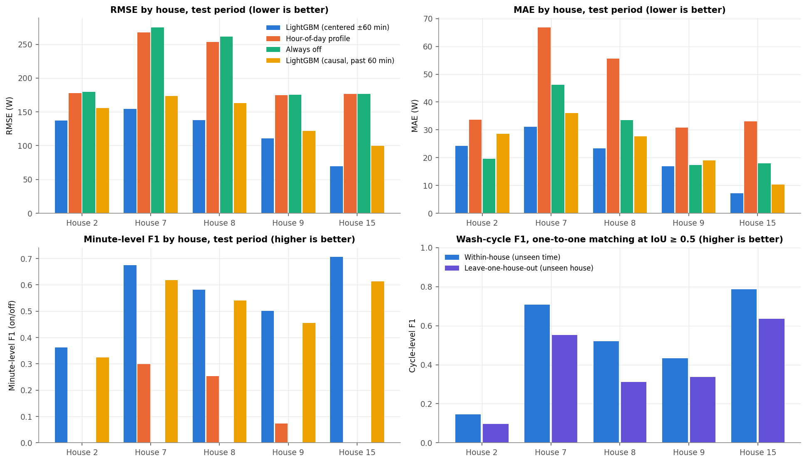
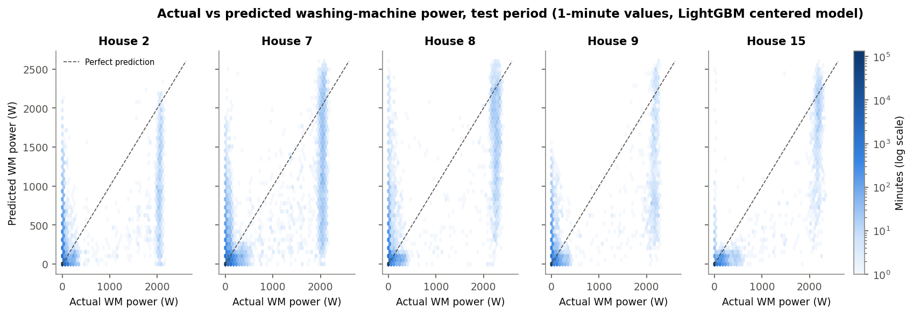
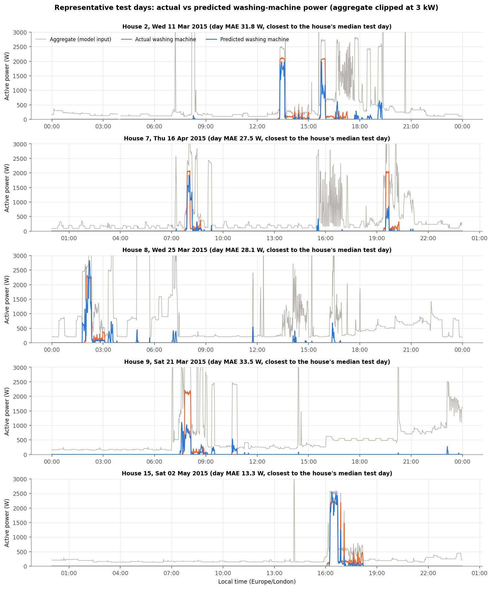
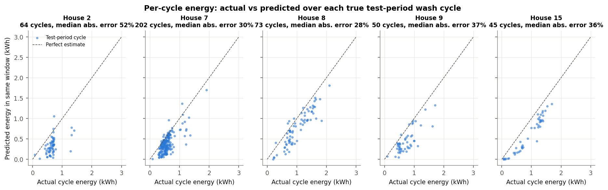
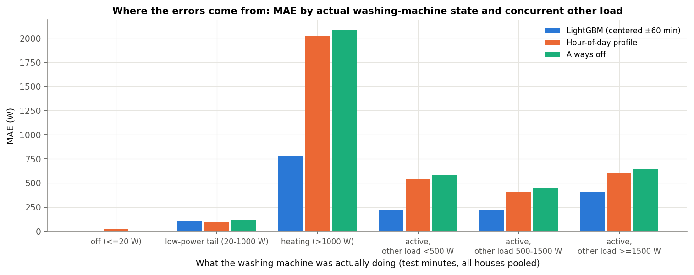
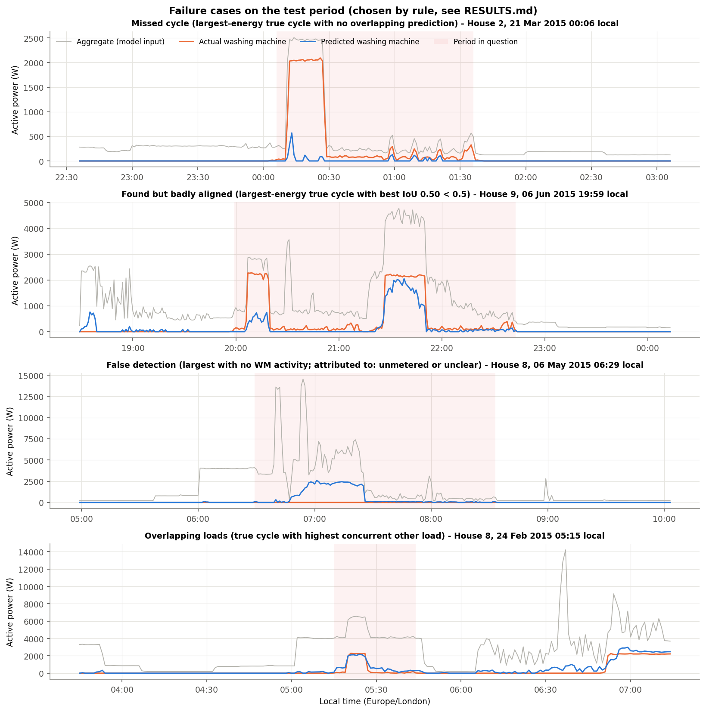

# Phase 3 Results: Washing-Machine Disaggregation from Whole-House Power

**Task:** estimate washing-machine (WM) power at 1-minute resolution from the whole-house aggregate only.
**Data:** official cleaned REFIT data for Houses 2, 7, 8, 9 and 15; the usable data and exclusions are described
in [DATA.md](DATA.md).
**Code:** [`wm_nilm.py`](wm_nilm.py) (`python3 phase3/wm_nilm.py`, about 2 min) or the notebook
[`03_wm_disaggregation.ipynb`](03_wm_disaggregation.ipynb). Both produce the same outputs.
**Numbers:** all values are in [`outputs/tables/phase3/`](../outputs/tables/phase3/). Headline values are in
[`17_key_numbers.csv`](../outputs/tables/phase3/17_key_numbers.csv).
**Clock correction:** the input timestamps are corrected to UTC (Phase 2 [DATA.md §1](../phase2/DATA.md#1-source-files)),
so hour-of-day features are right throughout. The changes against the uncorrected run are listed in
[`07_baseline_vs_corrected_metrics.csv`](../outputs/tables/audit/07_baseline_vs_corrected_metrics.csv).
They are small: minute F1 0.556 → 0.577, RMSE 128.3 → 126.0 W, cycle F1 0.533 → 0.536 (leave-one-house-out
0.399 → 0.398).

---

## 1. Summary

- **The model finds most wash cycles, but often mis-times them and raises many false alarms.** Cycles are
  scored by one-to-one matching at temporal IoU ≥ 0.5 (§2). On unseen 2015 test periods:
  - **recall is 77.6%** (337 of 434 true cycles matched)
  - **precision is 40.9%** (337 of 823 predicted cycles), giving **cycle F1 0.54**
  - most unmatched true cycles *are* overlapped by a prediction that covers only the heater block (85 of 97)
  - most unmatched predictions (386 of 486) touch no washing at all and coincide with dishwashers, kettles,
    tumble dryers or unmetered loads
- **It clearly beats both baselines on the metrics that matter for an appliance that is usually off:**

  | Pooled test metric | Model | Always off | Hour-of-day profile |
  |---|---|---|---|
  | RMSE | **126 W** | 220 W | 216 W |
  | Minute-level F1 | **0.58** | 0.00 | 0.23 |

- **Plain MAE is misleading here.** Always-off has a lower MAE than the model in House 2, and nearly matches it
  in House 9, because the machine is off about 95% of the time.
- **Total energy looks right for partly the wrong reason.**
  - Pooled test energy error is **−5.9%**.
  - But the model **under-estimates each true cycle**: it assigns only 50–76% of real cycle energy to the cycle
    window.
  - The gap is largely refilled by energy assigned to false detections.
- **On a never-seen house (leave-one-house-out), cycle recall falls to 67.7% and precision to 28.2% (F1 0.40).**
  Each fold's threshold is chosen without the held-out house (§6). Energy errors reach +37% to +42% in Houses 9
  and 8 and −50% in House 15. The model should not be assumed to transfer to new homes without local checks.

---

## 2. Set-up

| Item | Choice | Why |
|---|---|---|
| Target | 1-min mean WM power (W) | As required. Never used as an input: no lagged target values |
| Input | 1-min mean aggregate (W): values and rolling mean/std/min/max over past, future and centred 5/15/30/60 min; load above the local 2-hour minimum; count of > 1.5 kW step minutes in ±60 min; hour of day; weekend flag (48 features, [`run_info.json`](../outputs/models/phase3/run_info.json)) | The WM's clearest signature is a ~2 kW heater step lasting 10–20 min (Phase 2), which needs a window of context to recognise |
| Prediction timing | Uses aggregate up to **60 min after** the minute being estimated | The estimate exists 60 min after the fact. That suits billing, feedback and programme evaluation, not instant control. A **causal** variant (past 60 min only) is reported as a check |
| Model | LightGBM, squared-error loss, early stopping on validation | Fast (one fit takes about 10–15 s on ~2M training rows), handles missing values natively, easy to explain. The aim was a defensible model, not a high score |
| Post-processing | Clip to [0, aggregate]. Set predictions ≤ τ to 0, where τ = **50 W** is chosen on validation by maximising minute F1 ([`05_threshold_selection_val.csv`](../outputs/tables/phase3/05_threshold_selection_val.csv)). Leave-one-house-out folds choose their own τ (§6) | A WM cannot draw negative power or more than the whole house. Gating removes the small positive smear a squared-error model leaves on the ~95% of off minutes |
| Baselines | (1) **Always off** (0 W); (2) **Hour-of-day profile**: each house's mean WM power for each local hour, from its training period | The two simplest honest references: "no information", and "typical timing only" |
| Split | Per house, chronological 60/20/20 with 1-day buffers (DATA.md §5) | Prevents leakage between neighbouring minutes. The test is genuinely *later* than training |

**Metrics and why they are used**

| Metric | Meaning | Why it is useful here |
|---|---|---|
| MAE (W) | Mean absolute error per minute | Intuitive, but rewards predicting 0 for a mostly-off appliance |
| RMSE (W) | Root-mean-square error | Penalises missing a 2 kW heater block heavily, and those blocks hold most of the energy |
| MAE active (W) | MAE on minutes when the WM was truly on (> 20 W) | Isolates the minutes that matter |
| Energy error (%) | (predicted − actual) total WM energy over the test period | What a bill-level insight would use |
| Minute precision / recall / F1 | Predicted on (> τ) vs actually on (> 20 W) | Standard NILM on/off metrics |
| Cycle precision / recall / F1 | Phase 2's cycle rule is applied to the actual series (20 W) and the predicted series (τ). Cycles are then matched **one-to-one**: temporal IoU = minutes in both ÷ minutes in either, a pair is eligible only if IoU ≥ 0.5, and pairs are taken greedily from the highest IoU down with each cycle used at most once. Precision = matched ÷ predicted cycles; recall = matched ÷ true cycles. The criterion was fixed before evaluation. A looser one-to-one "any overlap" version is reported only as a sensitivity check | What a utility would act on ("did a wash happen, and when?"). One-to-one matching stops one long prediction from "detecting" several washes, and stops several fragments from all counting as correct |

---

## 3. Results on the test period: unseen time in the same households

Source: [`06_metrics_within_house.csv`](../outputs/tables/phase3/06_metrics_within_house.csv),
[`08_event_metrics.csv`](../outputs/tables/phase3/08_event_metrics.csv)

| House | Model | MAE (W) | RMSE (W) | MAE active (W) | Energy error | Minute F1 | Cycle recall | Cycle precision | Cycle F1 |
|---|---|---|---|---|---|---|---|---|---|
| 2 | **LightGBM** | 24.3 | **137.2** | **257.1** | +10.4% | **0.361** | 0.250 | 0.103 | **0.145** |
| | Hour profile | 33.6 | 177.9 | 383.8 | −14.0% | 0.000 | 0 | n/a | 0 |
| | Always off | **19.6** | 179.8 | 412.2 | −100% | 0 | 0 | n/a | 0 |
| 7 | **LightGBM** | **31.2** | **154.3** | **229.4** | −14.2% | **0.675** | 0.891 | 0.588 | **0.709** |
| | Hour profile | 66.9 | 267.5 | 425.5 | −29.6% | 0.300 | 0 | n/a | 0 |
| | Always off | 46.2 | 275.1 | 471.2 | −100% | 0 | 0 | n/a | 0 |
| 8 | **LightGBM** | **23.3** | **137.9** | **347.6** | +5.6% | **0.581** | 0.877 | 0.370 | **0.520** |
| | Hour profile | 55.6 | 253.4 | 831.9 | −13.5% | 0.253 | 0 | n/a | 0 |
| | Always off | 33.5 | 261.2 | 902.4 | −100% | 0 | 0 | n/a | 0 |
| 9 | **LightGBM** | **16.9** | **110.4** | **282.7** | +6.4% | **0.501** | 0.840 | 0.292 | **0.433** |
| | Hour profile | 30.9 | 174.5 | 527.9 | −13.7% | 0.074 | 0 | n/a | 0 |
| | Always off | 17.4 | 175.6 | 549.6 | −100% | 0 | 0 | n/a | 0 |
| 15 | **LightGBM** | **7.2** | **69.4** | **211.4** | −31.3% | **0.706** | 0.778 | 0.795 | **0.787** |
| | Hour profile | 33.1 | 176.6 | 564.9 | −10.5% | 0.000 | 0 | n/a | 0 |
| | Always off | 18.0 | 176.8 | 579.4 | −100% | 0 | 0 | n/a | 0 |
| **Pooled** | **LightGBM** | **20.8** | **126.0** | **255.7** | −5.9% | **0.577** | 0.776 | 0.409 | 0.536 |
| | Causal LightGBM | 24.5 | 146.1 | 304.2 | −11.5% | 0.524 | 0.765 | 0.364 | 0.493 |
| | Hour profile | 44.7 | 215.9 | 506.9 | −19.2% | 0.230 | 0 | n/a | 0 |
| | Always off | 27.5 | 220.3 | 546.5 | −100% | 0 | 0 | n/a | 0 |

Cycle columns use one-to-one matching at IoU ≥ 0.5. "n/a": the baseline never predicts a cycle, so precision is
undefined. The hour profile never exceeds τ long enough to form a cycle. Bold marks the best value per house where
the comparison is meaningful.

**Sensitivity of the cycle metrics to the matching criterion** (pooled within-house, from
[`17_key_numbers.csv`](../outputs/tables/phase3/17_key_numbers.csv)):

| Criterion | Matched | Recall | Precision | F1 |
|---|---|---|---|---|
| **One-to-one, IoU ≥ 0.5 (primary)** | 337 | 0.776 | 0.409 | 0.536 |
| One-to-one, any overlap (sensitivity) | 414 | 0.954 | 0.503 | 0.659 |

Of the 85 true cycles that are overlapped but below IoU 0.5 (§7.2), 77 are matched under the looser criterion
(414 − 337). The other 8 remain unmatched even then, because their only overlapping prediction is already matched
to another wash. That is exactly the double-counting one-to-one matching prevents. An earlier version of this
report used many-to-many overlap (97% recall, 52% precision). That method overstated detection, because one
prediction could count for several washes, and it has been replaced.

**Interpretation.**
- The model has the lowest **RMSE** and **MAE on active minutes** in every house. RMSE is 23–61% below the
  better baseline and active-minute MAE 33–63% below, and the model is the only method that detects anything.
- **MAE** favours always-off in House 2 (and is almost tied in House 9), because the model pays for false "on"
  estimates on the ~95% of off minutes. This is why MAE alone would be a misleading headline for a sparse appliance.
- The **causal** (real-time) variant is worse on RMSE and F1 in every house. Seeing what the aggregate does in the
  hour *after* a minute helps confirm a wash.
- **House 2** has very low cycle F1 (0.15) despite reasonable minute metrics. Its programmes are long (median
  ~98 min, Phase 2), and the predicted cycle usually covers only the heater block, so IoU stays below 0.5
  (46 of its 64 cycles are overlapped but unmatched, §7.2).
- **House 15** is the easiest home: high minute precision (0.88) and the lowest errors. Its aggregate is low and quiet
  (Phase 2: about 6 kWh/day), so the heater step stands out. Its energy is under-estimated by 31% because the
  long low-power tail is missed.

---

## 4. Actual vs predicted

Most minutes sit at (0, 0). True heater minutes (~2.0–2.3 kW) form a vertical band. The model usually
recognises them but often predicts less than the true value. True low-power minutes (20–500 W) are mostly
predicted near 0. A smaller cloud at "actual 0, predicted > 0" shows the false detections.

The days shown are chosen **by rule**, not hand-picked: for each house, the test day (≥ 95% usable, at least one
active minute) whose daily MAE is closest to that house's median day
([`15_typical_days.csv`](../outputs/tables/phase3/15_typical_days.csv)). Typical behaviour:
- The heater block is found in every house. It is under-sized when other loads run at the same time: House 9's
  busy morning (about 1 kW predicted against 2.2 kW actual) and House 7's evening cycle.
- In quiet periods it is tracked closely: House 15, House 2's first cycle and House 7's morning cycle.
- The long low-power tail is largely missed.
- Short spikes in the aggregate cause brief false estimates, most visibly in House 8.

---

## 5. Per-cycle energy: why total energy agreement is partly a coincidence

Source: [`09_cycle_energy_by_house.csv`](../outputs/tables/phase3/09_cycle_energy_by_house.csv)

| House | True test cycles | Actual energy in cycles (kWh) | Predicted energy in the same windows (kWh) | Median per-cycle abs. error | Predicted energy in false detections (kWh) | Total predicted (kWh) |
|---|---|---|---|---|---|---|
| 2 | 64 | 41.980 | 20.874 | 52% | 19.596 | 46.559 |
| 7 | 202 | 114.939 | 77.611 | 30% | 13.946 | 98.991 |
| 8 | 73 | 74.656 | 56.426 | 28% | 14.401 | 79.446 |
| 9 | 50 | 36.527 | 22.235 | 37% | 10.840 | 39.052 |
| 15 | 45 | 40.647 | 27.173 | 36% | 0.771 | 28.282 |

**Interpretation.** In every house the model assigns **less** energy to the true cycle windows than they actually
used: 50% of the real energy in House 2, 76% in House 8. The tail is the missing part. Totals look acceptable
(e.g. House 2: +10%) only because energy from false detections (House 2: 19.596 kWh) fills the gap. A utility using
the totals would be counting dishwasher and kettle energy as washing. **Totals should therefore not be read as
evidence of accurate per-cycle estimates.** House 15 has almost no false-detection energy and shows the
under-estimate plainly (−31%).

---

## 6. Unseen households: leave-one-house-out

Source: [`07_metrics_leave_one_house_out.csv`](../outputs/tables/phase3/07_metrics_leave_one_house_out.csv),
[`08_event_metrics.csv`](../outputs/tables/phase3/08_event_metrics.csv),
[`05b_loho_threshold_selection.csv`](../outputs/tables/phase3/05b_loho_threshold_selection.csv). Same test windows
as §3.

**Protocol per fold:**
- The model is fitted on the other four houses' training periods and early-stopped on *their* validation periods.
- The fold's "on" threshold τ is chosen by maximising minute F1 on *those four houses' validation periods only*.
- That τ is applied to the held-out house's test predictions, for both minute and cycle metrics.

The held-out house contributes nothing to fitting, early stopping or τ.

**Fold thresholds:** τ = 50 W in all five folds (held-out House 2, 7, 8, 9, 15), the same value as the
within-house model. An earlier version of this project took τ from validation data that included the held-out
house. That was a leak in principle, and it has been replaced by the fold-specific choice above.

| Held-out house | Fold τ (W) | MAE (W) | RMSE (W) | RMSE, always off | Energy error | Minute F1 | Cycle recall | Cycle precision | Cycle F1 | Cycle F1, within-house |
|---|---|---|---|---|---|---|---|---|---|---|
| 2 | 50 | 28.0 | 167.4 | 179.8 | −13.3% | 0.308 | 0.156 | 0.070 | 0.097 | 0.145 |
| 7 | 50 | 41.4 | 189.0 | 275.1 | −15.6% | 0.561 | 0.772 | 0.431 | 0.553 | 0.709 |
| 8 | 50 | 57.5 | 244.1 | 261.2 | **+42.0%** | 0.364 | 0.767 | 0.196 | 0.313 | 0.520 |
| 9 | 50 | 26.1 | 150.6 | 175.6 | **+37.4%** | 0.416 | 0.880 | 0.209 | 0.337 | 0.433 |
| 15 | 50 | 10.0 | 92.9 | 176.8 | **−49.7%** | 0.519 | 0.622 | 0.651 | 0.636 | 0.787 |
| Pooled | | | | | +0.4% | | 0.677 | 0.282 | 0.398 | 0.536 |

Cycle columns use one-to-one matching at IoU ≥ 0.5. With the looser one-to-one "any overlap" criterion, pooled
LOHO recall is 0.899, precision 0.374 and F1 0.528.

**Interpretation.** This is the only test of a never-seen home, and it covers just five houses from one UK region.
- **What holds up:** the model still beats always-off on RMSE in every held-out house (only just in House 8) and
  still matches most cycles in Houses 7, 8 and 9.
- **What gets worse:**
  - Cycle F1 falls in every house compared with the within-house model.
  - Precision falls sharply in Houses 2, 8 and 9, where most predicted cycles are not washes.
  - Total energy becomes unreliable (+42% and +37% in Houses 8 and 9, −50% in House 15). The pooled +0.4% hides
    these opposite-signed errors.
- **Why:** the new home's other appliances, and its washing machine's exact signature, were never in training.

**Cross-household generalisation is therefore weak to moderate. It should not be assumed without local
validation.**

---

## 7. Error analysis

### 7.1 Where the errors come from

Source: [`13_error_by_state_and_overlap.csv`](../outputs/tables/phase3/13_error_by_state_and_overlap.csv)
(all test minutes pooled)

| What the WM was actually doing | Share of test minutes | LightGBM MAE (bias) | Hour profile MAE | Always off MAE |
|---|---|---|---|---|
| Off (≤ 20 W) | 95.0% | 8.4 W (+8.1) | 20.3 W | 0.1 W |
| Low-power tail (20–1000 W) | 3.9% | 110.9 W (−34.4) | 89.2 W | 121.4 W |
| Heating (> 1000 W) | 1.1% | 779.9 W (−734.7) | 2018.7 W | 2084.7 W |
| Active, other load < 500 W | 2.3% | 216.8 W (−198.8) | 542.5 W | 578.4 W |
| Active, other load 500–1500 W | 1.7% | 216.8 W (−199.8) | 402.4 W | 444.6 W |
| Active, other load ≥ 1500 W | 1.0% | 404.6 W (−135.5) | 602.4 W | 645.3 W |

- **Heater minutes** have the largest error per minute, and the model **under-sizes** them (bias −735 W), but it
  still cuts the error by about 61% compared with the better baseline.
- **Low-power minutes** are barely better than always-off and *worse* than the hour profile. A few hundred watts of
  drum or spin cannot be separated from fridges, lighting and electronics in the aggregate.
- **Overlapping loads:** MAE during active minutes almost doubles when ≥ 1.5 kW of other load runs at the same time.
- **Off minutes:** the model adds a small positive error (+8.1 W bias). These are its false "on" estimates.

### 7.2 Unmatched true cycles

Source: [`10_test_true_cycles.csv`](../outputs/tables/phase3/10_test_true_cycles.csv) (`status` column),
[`12_missed_cycles.csv`](../outputs/tables/phase3/12_missed_cycles.csv),
[`12b_missed_vs_detected.csv`](../outputs/tables/phase3/12b_missed_vs_detected.csv)

| Outcome (IoU ≥ 0.5 matching) | Cycles | Median energy | Heated (> 1 kW) | Median duration | Median concurrent other load | Median best IoU with any prediction |
|---|---|---|---|---|---|---|
| Matched | 337 | 0.622 kWh | 99.7% | 67 min | 912 W | 0.875 |
| Overlapped, IoU below 0.5 | 85 | 0.609 kWh | 97.6% | 91 min | 928 W | 0.326 |
| No overlap at all | 12 | 0.203 kWh | 66.7% | 44.5 min | 412 W | 0 |

| House | Matched | Overlapped, IoU < 0.5 | No overlap |
|---|---|---|---|
| 2 | 16 | 46 | 2 |
| 7 | 180 | 20 | 2 |
| 8 | 64 | 8 | 1 |
| 9 | 42 | 7 | 1 |
| 15 | 35 | 4 | 6 |

Unmatched true cycles fall into two groups:
- **Found but mis-timed (85):** ordinary heated cycles, usually overlapped by exactly one predicted cycle (81%). That
  prediction covers the heater block but stops early because the low-power tail is missed, so the IoU is about
  0.3. They are longer than matched cycles (median 91 vs 67 min), and House 2 (long programmes) accounts for 46. Some of these "true
  cycles" are probably two back-to-back loads that the Phase 2 rule joins into one (see failure case 2), so part
  of the error lies in the ground-truth definition.
- **Not found at all (12; 6 in House 15):** mostly small, short and often unheated. These are cold or quick
  programmes whose only signature is the weak tail. Occasionally a clear heater block is under-sized so much that
  it never forms a predicted cycle (failure case 1).

### 7.3 False detections

Source: [`11_false_detections_attributed.csv`](../outputs/tables/phase3/11_false_detections_attributed.csv).
Of the 486 unmatched predicted cycles (within-house):
- **100** overlap some real WM activity. These are mis-timed or fragmented estimates of a real wash.
- **386** overlap no WM activity at all. These *pure false detections* are analysed here.

Each pure false detection is attributed to the other **sub-metered** appliance with the most energy in that window,
but only if that appliance used at least half of the falsely predicted energy. Otherwise the cause is "unmetered or
unclear".

| Attributed cause | False detections | Falsely predicted WM energy (kWh) |
|---|---|---|
| Dishwasher | 128 | 15.9 |
| Unmetered or unclear | 112 | 21.6 |
| Tumble dryer | 54 | 9.8 |
| Kettle | 50 | 4.6 |
| Washer-dryer (separate machine, Houses 8 and 9) | 16 | 5.3 |
| Microwave | 15 | 1.2 |
| Other (TV site, fridge-freezer, toaster, freezer) | 11 | 1.0 |

Per house:
- **Houses 2 and 9:** dishwashers dominate (46 and 48).
- **House 7:** its tumble dryer accounts for 49, then the dishwasher for 34.
- **House 8:** most false detections (65) have no metered cause. Its aggregate carries large unmetered loads (DATA.md §6).

All the main culprits have **~2 kW heating elements**, like the washing machine's heater, so a heater step alone
does not identify the appliance.

### 7.4 Failure cases (chosen by rule)

[`16_failure_cases.csv`](../outputs/tables/phase3/16_failure_cases.csv)

1. **Missed cycle** (the largest-energy true cycle with no overlapping prediction; House 2, 21 Mar 2015, just after
   midnight local time). The ~2 kW heater block is clear in a quiet aggregate, yet the model outputs only a brief
   ~0.6 kW spike, too short to form a predicted cycle. Washing at that hour is unusual for this house, and the
   model partly relies on hour-of-day features (§8). That may contribute, but it is not proven.
2. **Found but badly aligned** (the largest-energy true cycle overlapped below IoU 0.5; House 9, 6 Jun 2015,
   evening; best IoU just under 0.5). The Phase 2 rule joins about 2.7 hours with two heater blocks (probably two
   loads) into one true cycle. The model predicts the second heater block well and the first only weakly, as
   separate cycles. No single predicted cycle covers half of it, so one-to-one matching counts it as unmatched.
3. **False detection** (the largest predicted cycle that overlaps no WM activity; House 8, 6 May 2015, morning).
   During a period of large unmetered loads (spikes to ~14 kW and a sustained 4–7 kW stretch), the model predicts a
   125-minute "cycle" peaking at 2.6 kW (1.34 kWh), mostly as a ~2.4 kW block of about 40 min. No sub-meter
   explains it.
4. **Overlapping loads** (the true cycle with the highest concurrent other load; House 8, 24 Feb 2015). The heater
   is tracked, but energy leaks into the surrounding 4–6 kW period.

### 7.5 Where the model is likely to struggle

- **Homes with other ~2 kW heating appliances** (dishwasher, tumble dryer, washer-dryer, kettle, immersion
  heater), especially when those run at times when washing is also common.
- **Cold or short washes** with no heater block: they are missed or badly under-estimated.
- **Long programmes and back-to-back loads:** the predicted cycle ends with the heater block, so start and end
  times (and IoU) are poor even when the wash is found.
- **Busy periods** (cooking, showers) where the heater step overlaps other large loads.
- **New homes** (§6): precision and energy accuracy drop without local training data.

---

## 8. Model behaviour

[`14_feature_importance.csv`](../outputs/tables/phase3/14_feature_importance.csv). The most-used features
(share of total gain):

| Feature | Gain share |
|---|---|
| Load above the local 2-hour minimum (`excess_over_base`) | 11.7% |
| Minimum aggregate over the past 5 min | 8.6% |
| Minimum aggregate over the centred ±5 min | 5.2% |
| Hour of day (sin) | 4.7% |
| Number of > 1.5 kW step minutes in ±60 min | 4.5% |

These features capture a **sustained** step above the baseline. A short kettle spike raises the maximum but not
the 5-minute minimum, while a 10–20-minute heater block raises both. Hour of day contributes too, which ties the
model partly to each house's routine (Phase 2) and is one reason transfer to new homes is weaker.

Validation results (pooled): MAE 24.3 W, RMSE 139.1 W, F1 0.49, energy error +7.3%. These are in line with the
test results, so there is no sign of over-fitting to the validation period.

---

## 9. Research ideas adopted

| Source | Idea used here |
|---|---|
| Murray, D., Stankovic, L., Stankovic, V. (2017). *An electrical load measurements dataset of United Kingdom households from a two-year longitudinal study.* Scientific Data 4, 160122 | Dataset description, channel meanings and known collection issues |
| Zhang, C., Zhong, M., Wang, Z., Goddard, N., Sutton, C. (2018). *Sequence-to-point learning with neural networks for non-intrusive load monitoring.* AAAI | Predict the appliance's value at one point from a **window of aggregate centred on it**. Here that is a ±60-min window summarised into features for a tree model rather than a CNN |
| Kelly, J., Knottenbelt, W. (2015). *Neural NILM: Deep neural networks applied to energy disaggregation.* ACM BuildSys | **On-power thresholds** with precision/recall/F1 alongside energy errors, and testing on **unseen houses** as the real generalisation check |
| Batra, N. et al. (2014). *NILMTK: an open source toolkit for non-intrusive load monitoring.* ACM e-Energy | Reporting several complementary metrics (error in W, energy error, on/off F1) rather than one score |

All modelling and evaluation code here is my own. No pre-trained models or NILM toolkits were used.

---

## 10. Limitations

> **Limitation:** ground truth is the WM sub-meter. Sub-meter and aggregate are not synchronised to the second,
> so a minute or two of timing error at cycle edges is unavoidable.

> **Limitation:** five houses, one region, 2013–2015 appliances. The leave-one-house-out results are the only
> cross-household evidence and rest on five folds.

> **Limitation:** test periods are late winter to summer 2015 only. Performance in other seasons, when heating
> loads overlap more, may differ.

> **Limitation:** τ (50 W) and the Phase 2 cycle rule shape the event metrics. Different thresholds would shift
> the precision/recall balance.

> **Note: clock correction.** In the official files' Part 2 summer periods, `Unix` is the UK local clock. The
> input is now corrected to UTC (Phase 2 DATA.md §1), so the hour-of-day features and the hour-profile baseline
> are right. Without the correction they were one hour late for about two-thirds of test minutes. The corrected
> run changes the headline metrics only slightly (see the clock-correction line at the top).

> **Limitation:** false-detection attribution only sees sub-metered appliances. "Unmetered or unclear" cases
> cannot be explained further from this data.

**What I would try next (not done):**
1. Add a second-stage cycle classifier on detected events (duration, heater timing, tail shape) to reject
   dishwasher and tumble-dryer look-alikes.
2. Model the low-power tail explicitly, for example by predicting cycle energy per detected event instead of
   per minute.
3. Fine-tune with a few labelled cycles per new home, since leave-one-house-out shows home-specific signatures
   matter.
