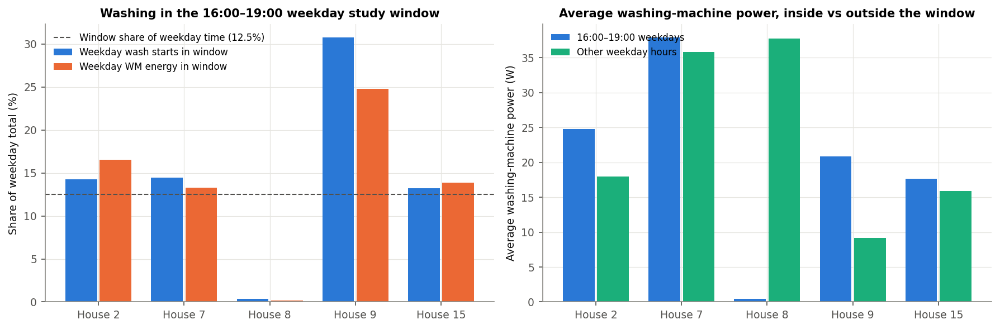
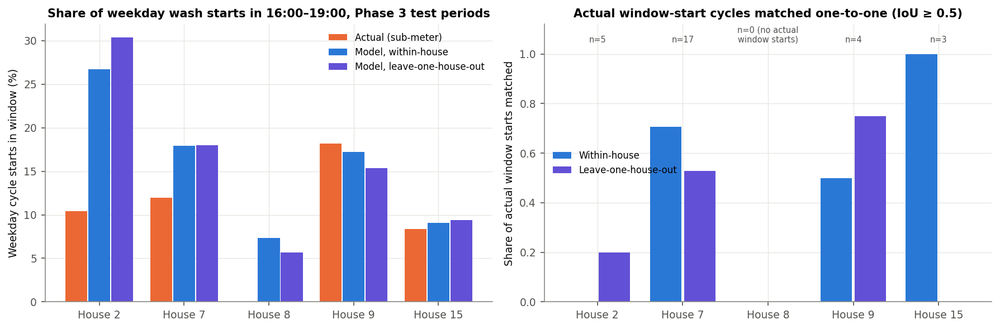
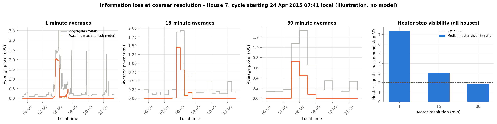

# Phase 4 Results: Practical Implications

This document has the full answers to the assignment's Section 4 and the analysis behind them. The one-page
utility summary is [Recommendation.md](../Recommendation.md) at the repository root.

**Code:** [`phase4_analysis.py`](phase4_analysis.py) (`python3 phase4/phase4_analysis.py`, ~10 s) or the notebook
[`04_practical_implications.ipynb`](04_practical_implications.ipynb).
**Numbers:** all values are in [`outputs/tables/phase4/`](../outputs/tables/phase4/).
**Scope:**
- Phase 4 only *reads* Phase 2/3 data and outputs. No model is trained or tuned.
- Houses 2, 7, 8, 9 and 15 are used, with Phase 3's usability masks (DATA.md in phase3). House 5 stays excluded
  as a probable washer-dryer.

> **Assumption: study window.** "Peak" here means **weekdays 16:00–18:59 on the UK local clock**
> (Europe/London). This window was chosen for the study as a typical evening-peak period. It is not an official
> or universal UK peak definition. Network peaks vary by region, season and tariff.

> **Daylight saving is handled.** Every minute is converted from UTC to local time before testing weekday and
> hour. [`01_dst_window_check.csv`](../outputs/tables/phase4/01_dst_window_check.csv) confirms that:
> - every complete weekday in every house has exactly 180 window minutes, including the Mondays after each clock
>   change
> - the window sits at 16:00–18:59 UTC under GMT and 15:00–17:59 UTC under BST

---

## 1. The opportunity: shift washing out of the evening peak

### 1.1 What it is, and what it is not

The washing machine is a **schedulable ~2 kW load**: the heater runs for 10–20 minutes near the start of a cycle
(Phases 2 and 3). Encouraging households to run it outside 16:00–19:00 can **lower demand in that window**,
for example through a time-of-use tariff, delay-start reminders or app feedback.

> **This is peak-demand reduction, not energy saving.** A wash that is moved still uses the same kWh, just at
> another time. The benefit is lower network or generation stress in the window and, under a time-of-use tariff,
> a lower bill. It does **not** reduce total consumption.

### 1.2 How much washing falls in the window (sub-metered data, full usable record)

Source: [`02_peak_window_exposure.csv`](../outputs/tables/phase4/02_peak_window_exposure.csv)

| House | Weekday washes | Starting in window | % of weekday starts in window | % of weekday WM energy in window | Avg WM power in window | Avg WM power, other weekday hours | Est. WM kWh/year in window | WM share of whole-house window energy |
|---|---|---|---|---|---|---|---|---|
| 2 | 238 | 34 | 14.3% | 16.5% | 24.8 W | 17.9 W | 19.4 | 3.7% |
| 7 | 589 | 85 | 14.4% | 13.3% | 37.9 W | 35.8 W | 29.7 | 3.7% |
| 8 | 277 | 1 | 0.4% | 0.2% | 0.4 W | 37.8 W | 0.3 | 0.07% |
| 9 | 117 | 36 | 30.8% | 24.8% | 20.8 W | 9.1 W | 16.3 | 2.6% |
| 15 | 174 | 23 | 13.2% | 13.9% | 17.6 W | 15.9 W | 13.8 | 6.0% |
| **Pooled** | **1,395** | **179** | **12.8%** | **11.1%** | **20.6 W** | **23.7 W** | **16.1** | **3.0%** |

"Weekday washes" are likely wash cycles (Phase 2 rule) starting Monday–Friday. "Avg WM power in window" is the
mean over all observed window minutes, whether or not the machine was running. The pooled value is total window
WM energy ÷ total observed window hours, i.e. a per-household average.

> **Assumption: annualisation.** Est. kWh/year = average WM power in the window × 3 h × 261 weekdays.
> - Bank holidays are not removed.
> - Seasonal coverage is uneven: outages in early 2014 and May–June 2015 hit several houses. The figure is a rough
>   scale, not a forecast.
> - It is energy **exposed** to the window, **not** energy that would be shifted.

**What this shows**
- **These homes do not concentrate washing in the evening peak.** Pooled, 12.8% of weekday washes start in the
  window, about the window's 12.5% share of weekday time.
- **The homes differ a lot.** House 9 starts 30.8% of weekday washes in the window. House 8 starts almost none
  (1 of 277), because it washes overnight.
- **The per-household lever is small.** The machine adds on average **20.6 W** to a household's window demand,
  against **0.686 kW** of whole-house demand (3.0%). Even in the most exposed home (House 7) it is about 38 W.
- **Not all window energy can be moved by "start later".**
  - Of 107.2 kWh of WM energy observed in the window, 91.9 kWh came from cycles that *started* in the window.
  - 14.7 kWh came from cycles that started *before 16:00* and ran into it.
  - Cycles that start in the window keep a median **94%** of their energy inside it, so a start would need to move
    well clear of the window, not just slightly, for the whole cycle to leave it.

### 1.3 Can the disaggregation model identify peak-window washing?

The question is whether a utility could use the Phase 3 model, instead of sub-meters, to find peak-time washers.
Actual and predicted values are computed on **exactly the same Phase 3 test rows**, with:
- the same usability masks and cycle rule
- the same window definition
- Phase 3's thresholds (within-house τ = 50 W; each leave-one-house-out fold's own τ = 50 W)

The headline uses **one-to-one matching at IoU ≥ 0.5**.

Source: [`05_model_vs_actual_window_starts.csv`](../outputs/tables/phase4/05_model_vs_actual_window_starts.csv)

| House | Actual: window starts / weekday cycles | Actual % | Within-house predicted % (error) | Within: actual window washes matched | Within: predicted window starts that are real | LOHO predicted % (error) | LOHO: actual matched | LOHO: predicted real |
|---|---|---|---|---|---|---|---|---|
| 2 | 5 / 48 | 10.4% | 26.7% (+16.3 pp) | 0 of 5 | 0 of 31 | 30.4% (+19.9 pp) | 1 of 5 | 1 of 34 |
| 7 | 17 / 142 | 12.0% | 17.9% (+5.9 pp) | 12 of 17 | 11 of 36 | 18.0% (+6.0 pp) | 9 of 17 | 9 of 43 |
| 8 | 0 / 62 | 0.0% | 7.4% (+7.4 pp) | — (none to find) | 0 of 10 | 5.7% (+5.7 pp) | — | 0 of 12 |
| 9 | 4 / 22 | 18.2% | 17.2% (−0.9 pp) | 2 of 4 | 2 of 15 | 15.3% (−2.9 pp) | 3 of 4 | 3 of 21 |
| 15 | 3 / 36 | 8.3% | 9.1% (+0.8 pp) | 3 of 3 | 2 of 3 | 9.4% (+1.0 pp) | 0 of 3 | 0 of 3 |
| **Pooled** | **29 / 310** | **9.4%** | **16.6% (+7.2 pp)** | **17 of 29 (58.6%)** | **15 of 95 (15.8%)** | **15.4% (+6.1 pp)** | **13 of 29 (44.8%)** | **13 of 113 (11.5%)** |

"pp" means percentage points. The mean absolute per-house error in the window share is 6.3 pp within-house and
7.1 pp LOHO. "Matched" and "real" counts can differ slightly, because a matched pair can straddle 16:00 (for
example, a true start at 16:05 matched to a predicted start at 15:55).

*Sensitivity only (not a headline):* with the looser one-to-one "any overlap" criterion, pooled window recall is
86.2% and precision 25.3% within-house, and 89.7% and 22.1% LOHO. This shows that many washes are *touched* by a
prediction even when the timing is poor. It does not mean those washes are reliably detected.

**What this shows**
- **The model over-states peak-window washing**: 16.6% vs 9.4% pooled, and House 2 by +16.3 pp.
- **Strict matching:** it recovers only about half of the real window-start washes. Most of its predicted
  window starts (84.2% within-house, 88.5% LOHO) are not real washes. These are false detections from dishwashers,
  kettles and similar loads (Phase 3) that happen to fall in the evening.
- It does rank House 8 (the overnight washer) lowest, and it is close for Houses 9 and 15.
- **The test periods contain only 29 actual window-start washes in total** (0–17 per house), so every per-house
  figure above is very uncertain.
- **Conclusion:** the model is **not reliable enough to target individual households or to measure a programme's
  effect**. At most it could give a rough first screen that needs confirming with the customer or with direct
  meter data.

### 1.4 How to measure whether it worked: a randomised pilot

| Element | Design |
|---|---|
| Design | **Randomised controlled trial.** Recruit eligible households (smart meter, own a washing machine) and randomise them to *intervention* (time-of-use price signal or delay-start prompts) or *control* (no change). Randomise within strata (region, baseline window demand, household size) so the groups are comparable |
| Baseline | Several weeks of pre-intervention meter data for both groups |
| **Primary outcome** | **Average whole-house kW during weekdays 16:00–19:00**, per household, from **direct meter readings** |
| Secondary outcomes | (a) **Maximum 30-minute whole-house demand** within the window (the peak a network sees); (b) **whole-house kWh in the window**; (c) whole-day kWh, to confirm the load was moved rather than removed or added |
| Analysis | Intervention vs control difference in the outcome, adjusted for each home's baseline (ANCOVA or difference-in-differences), with confidence intervals. Outcomes never come from disaggregation estimates. The Phase 3 model has known bias and false detections, so it cannot measure the effect |
| Seasonality | Run both arms over the **same calendar period** and long enough to cover weekday and weekly cycles. Report results by season if the trial spans one. Do not compare before vs after in the intervention group alone |
| Attrition | Track drop-outs and meter-data gaps by arm. Analyse everyone as randomised (intention-to-treat). Check whether drop-outs differ in baseline demand |
| Comparability | Check that the arms are balanced on baseline window kW, household size and tariff. Keep the control group away from the messaging |
| Sample size | Must be planned from the pilot's own baseline variance. See the illustration below |

**Illustrative sample size** ([`08_illustrative_sample_size.csv`](../outputs/tables/phase4/08_illustrative_sample_size.csv)).
This is a simple two-arm comparison of household means (5% two-sided significance, 80% power). The
between-household SD of average window kW is 0.261 kW, taken from **only five REFIT homes**:

| Assumed reduction in average window kW | Households per arm |
|---|---|
| 21 W: *all* of the pooled WM window power removed (a ceiling) | 2,517 |
| 10 W (half) | 10,068 |
| 5 W (a quarter) | 40,271 |

This is illustrative only, but the message is robust. **A washing-machine-only peak-shifting effect is small next
to normal differences between homes.** A pilot would need thousands of households per arm unless it:
- uses baseline adjustment or within-home designs, which reduce the variance substantially
- targets homes that wash in the peak, identified from their own meter data and customer survey (not from the
  model alone)
- bundles the washing machine with other flexible loads (dishwasher, tumble dryer, EV charging)

### 1.5 Secondary idea: cold or cooler washing (no savings estimate)

In the sub-metered data, **81.3%** of washing-machine energy is drawn while the heater is on (1-minute power above
1 kW; range 77.5–89.2% by house,
[`04_heating_energy_share.csv`](../outputs/tables/phase4/04_heating_energy_share.csv)). Heating water dominates
the machine's energy, so promoting cooler washes is a plausible **energy-saving** message.

**No savings figure is given**, for three reasons:
- a cooler wash still heats water, just to a lower temperature
- this dataset does not record programme temperatures
- the Phase 3 model under-estimates heater energy and cannot measure changes in it

The same randomised design would apply, with whole-day kWh as the outcome.

---

## 2. Limitations

### 2.1 Overlapping appliance signatures (evidence from this project)
- Most Phase 3 false detections coincide with **dishwashers, kettles, tumble dryers**, a separate washer-dryer, or
  unmetered loads. These also have ~2 kW heating elements (Phase 3 RESULTS §7.3).
- The washing machine's low-power tail (drum, rinse, spin) cannot be separated from fridges, lighting and
  electronics, so cycle energy is under-estimated and cycle end times are poor (Phase 3 §5 and §7.2).

### 2.2 Missing data (evidence)
- Study-wide outages affect several houses at once (Phase 2 DATA.md §5).
- Frozen loggers make "0 W" readings unreliable, and whole days had to be excluded (Phase 3 DATA.md §3).
- Seasonal coverage is uneven, which limits annual estimates (§1.2 above).

### 2.3 Household differences (evidence)
- Window exposure ranges from 0.4% to 30.8% of weekday starts (§1.2).
- On an unseen house, cycle F1 is 0.40 vs 0.53 within-house, and energy errors reach ±50% (Phase 3 §6).
- A model trained on some homes does not transfer reliably to others.

### 2.4 Applying UK results to India

**What this dataset shows (UK REFIT, 2013–2015):**
- The modelled homes are five households from one English region (Loughborough area).
- Their washing machines heat water internally: a ~2 kW heater block appears in 97.9–100% of complete cycles
  (Phase 2 `06_cycle_summary_by_house.csv`).
- That heater block is the model's strongest signal.

**Reasoned hypotheses about Indian households.** These are *not* tested here and nothing in REFIT supports or
refutes them:
- **Appliances:** semi-automatic and top-loading machines, and cold-water washing without an internal heater, may
  be common. If so, the signal the model relies on would be weak or absent.
- **Other loads:** water heaters (geysers), air conditioners, pumps and inverter/battery backup may dominate or
  distort the aggregate, especially at peak times. Some of these have heating signatures similar to a washing
  machine's.
- **Supply and metering:** power cuts, voltage variation and different smart-meter resolutions could change data
  quality.
- **Household and tariff context:** larger or multi-generation households, different laundry routines and
  different tariff structures could change both usage timing and the incentive to shift.

**Why Indian sub-metered data are required:** the model learns appliance signatures and household routines from
its training data. Phase 3 shows it degrades even between UK homes. Before any use in India it would need:
1. **Training data** from Indian homes with sub-metered washing machines (and the other common appliances).
2. **Validation** on held-out Indian households, using the same leakage-safe protocol.
3. **A re-check of the cycle definition and thresholds**, which were derived from UK machines.

---

## 3. What becomes harder with 15- or 30-minute smart-meter data

> **Limitation:** the numbers below illustrate *information loss* using the same test data averaged to coarser
> intervals. They are **not** results of a validated 15- or 30-minute disaggregation model. No model was
> retrained.

Source: [`06_resolution_visibility.csv`](../outputs/tables/phase4/06_resolution_visibility.csv) (400 heated,
complete test-period cycles). Signal = the highest interval-average WM power during the cycle. Background = SD of
interval-to-interval changes in the *other* load when the machine is off.

| Resolution | Median heater signal | Median signal ÷ background SD | Cycles with ratio ≥ 2 | WM-off intervals where other load changes ≥ median heater signal (by house) |
|---|---|---|---|---|
| 1 min | 2,118 W | 7.42 | 100% | 0.1–0.8% |
| 15 min | 1,546 W | 3.02 | 83.5% | 0.02–4.5% |
| 30 min | 923 W | 1.87 | 40.8% | 0.2–9.2% |

**Paragraph answer.** With only 15- or 30-minute data, the washing machine's main signature is largely averaged
away:
- A 2 kW heater running for 10–20 minutes becomes a modest rise in one or two intervals. Its median height falls
  from about 2.1 kW to 0.9 kW at 30 minutes.
- Normal swings in other loads become relatively larger, so the median visibility ratio drops from 7.4 to 1.9.
- At 30 minutes, other appliances change by as much as a typical heater block in up to about 9% of the intervals
  when the machine is off.
- The shape that separates a wash from a kettle, shower or dishwasher (step height, duration, low-power tail)
  can no longer be seen inside an interval.
- Exact start times, cycle counts and per-cycle energy become largely unrecoverable.
- What remains feasible is coarser: estimates of how often a household runs large ~2 kW loads, and statistical
  or monthly estimates of washing energy, ideally helped by customer surveys.
- Peak-shifting programmes can still be **measured** at 30-minute resolution, because the outcome is
  whole-house demand in the window. They just cannot be **targeted** reliably from disaggregation.
- Quiet homes are the exception. In the single-occupant House 15, the step stays visible even at 30 minutes.

---

## 4. Assumptions made in Phase 4

1. The study window is weekdays 16:00–18:59 UK local clock time. Bank holidays are treated as weekdays.
2. Annualisation uses 261 weekdays × 3 h at the observed average window power.
3. "Wash" means a Phase 2 likely cycle (> 20 W, pauses ≤ 15 min joined, 10–300 min, ≥ 0.05 kWh, peak > 200 W). A
   cycle's timing is its start minute.
4. The model comparison uses only Phase 3 test periods, Phase 3 thresholds and one-to-one IoU ≥ 0.5 matching.
5. The 15/30-minute intervals are clock-aligned, and an interval is used only if all its minutes are present.
6. The sample-size figures use the between-household SD from five homes and hypothetical effect sizes.
